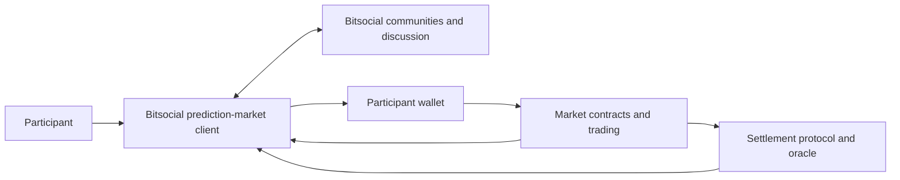

# Prediction Markets on Bitsocial

Open research into prediction markets with native, peer-to-peer communities, discussion, and discovery.

> **Status:** exploration; no implementation or agreed partnership yet.
> **Started:** 2026-09-10.
> **First integration candidate:** [Trueo](research/trueo.md).

We think prediction markets and decentralized social communities could work well together. This
repository explores what that could look like on [Bitsocial](https://bitsocial.net), starting with
Trueo. Contributors are welcome to research, prototype, and lead implementations.

Bitsocial is a grassroots ecosystem. This idea is open for anyone to pursue: an independent
developer, a community, an existing client team, or a prediction-market project. Publishing it
makes the opportunity discoverable; it does not assign delivery to Bitsocial Forge or any
particular maintainer.

## The idea

A prediction market has a question, competing views, evidence, and an eventual outcome. Those are
also the ingredients of a discussion thread. An app could put the market and its conversation
together, so people can discover a question, discuss the evidence, take a position, and return for
the result in the same place.

The opportunity is especially interesting for communities with questions that receive little
attention elsewhere, including contentious public questions that a centralized venue might
decline to list. The hypothesis is that community-led discovery and market creation can make
those markets useful. Each settlement protocol still has its own eligibility rules.

Bitsocial offers a foundation for the social side: independent clients, community-controlled
publishing, and peer-to-peer content. A prediction-market protocol could supply outcome tokens,
trading, collateral, and settlement. Existing starting points include
[5chan](https://github.com/bitsocialnet/5chan), [Seedit](https://github.com/bitsocialnet/seedit), and
[Bitsocial React Hooks](https://github.com/bitsocialnet/bitsocial-react-hooks).

## What contributors could build

| Direction | Possible experience | First useful experiment |
| --- | --- | --- |
| Market cards in an existing client | A thread displays a market, its rules, current state, and a trading link. | Render one real market inside a 5chan or Seedit prototype. |
| A dedicated prediction-market client | Markets become the main feed, with Bitsocial communities and discussions around them. | Build one market page with a real Bitsocial thread. |
| A Bitsocial social layer for Trueo | A Trueo-focused app presents markets alongside portable community discussions. | Map one Trueo market to a thread and demonstrate it in two clients. |

These are alternative starting points. A contributor can pursue one without committing to all
three. Trueo is the first candidate to investigate; research on other settlement protocols is
welcome.

## Responsibilities

The proposed client joins two systems. Bitsocial carries discussion and community activity. The
chosen market protocol determines financial outcomes. A community vote or moderator action must
not be presented as settlement authority. Switching social clients should preserve references to
the same market and its existing liquidity.

Censorship resistance needs to be assessed across the whole path: community operation, content
availability, clients, discovery, RPC access, contracts, and resolution. Independent clients and
replaceable infrastructure can reduce dependencies; a thread alone does not remove every one.

## Start with one community and one market

The first experiment should answer whether an actual community finds the combined experience
useful. Identify a question people already care about, an understandable resolution process, and
participants willing to supply liquidity and trade. A hypothetical example is a public software
release before a specified deadline, with the release tag and official announcement defined as
evidence.

Start with a readable market card and a working discussion. Add wallet transactions after the
integration has been investigated. Measure whether people return, discuss evidence, and use the
market at the sizes they intended. An announcement, token interest, or a controversial topic
alone does not establish demand.

See [the prototype brief](prototype.md) for a bounded first build and its completion criteria.

## Research and contribution map

| Work | Starting point | Status |
| --- | --- | --- |
| Trueo integration and possible collaboration | [Research note](research/trueo.md) | Candidate documented; integration untested |
| One-market prototype | [Prototype brief](prototype.md) | Open for contributors |
| Community demand and liquidity | [First experiment](#start-with-one-community-and-one-market) | Community and participants needed |
| Other settlement protocols | [Contribution guide](CONTRIBUTING.md) | Research welcome |

Open an [issue](https://github.com/bitsocialnet/prediction-markets/issues) with the piece you want
to explore, a question, or a prototype link. Small findings and competing approaches are useful.
See [CONTRIBUTING.md](CONTRIBUTING.md) for suggested first contributions.

The Trueo possibility should be revisited when a contributor takes on the prototype, a community
brings concrete demand, or Trueo publishes new integration support. Record findings and changes
here so the opportunity remains visible.

## License

[GPL-3.0-or-later](LICENSE), following the existing Bitsocial exploratory project precedent.
Linked third-party material retains its own license.
